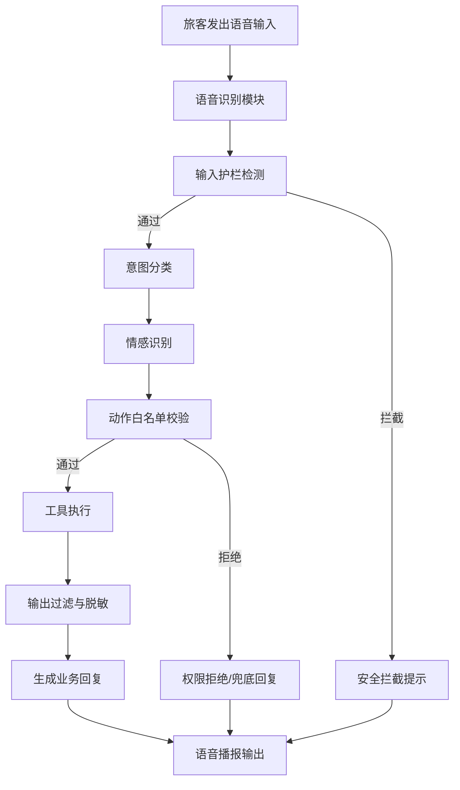

# 技术摸底书补充：机场智能服务 Agent 与安全防护技术

## 1. 项目背景与技术目标

本项目基于机场自助服务场景，构建了一套面向旅客的智能服务 Agent 系统，目标是在不引入大规模人工客服的前提下，提供“问答、导航、行程建议、情绪安抚、安检/行李/航班相关信息查询”一体化服务，并将其与安全防护机制深度耦合。

从技术实现上看，该系统具备以下特点：

- 通过确定性状态机进行多阶段处理，避免自由生成式流程失控；
- 通过输入防护、运行时权限控制和输出过滤形成三道安全防线；
- 通过意图识别、情绪识别和实体抽取，实现面向机场场景的业务理解；
- 通过知识库检索、POI 推荐和行程规划，提升服务的实用性和可执行性。

---

## 2. 代码实现对应关系

### 2.1 智能体调度与状态机

核心调度逻辑位于：
- [backend/agent/dispatcher.js](../backend/agent/dispatcher.js)

其实现方式包括：
- 采用“INIT → GUARDRAIL_CHECK → INTENT_CLASSIFY → ACTION_ROUTE → OUTPUT_FILTER → DONE”的状态流转；
- 将自然语言输入映射为确定性的动作白名单，减少不受控的工具调用；
- 对每一步处理过程生成审计信息，便于后续追踪与安全分析。

### 2.2 输入防护与注入检测

输入防护模块位于：
- [backend/agent/guardrail.js](../backend/agent/guardrail.js)

其功能包括：
- 检测 Prompt Injection、SQL 注入、命令注入和 XSS 攻击；
- 对 PII 数据进行脱敏处理；
- 对输出内容进行二次过滤，避免内部配置信息泄露。

### 2.3 意图识别、情绪识别与实体抽取

意图理解与情绪识别模块位于：
- [backend/agent/intent-classifier.js](../backend/agent/intent-classifier.js)
- [backend/agent/emotion-module.js](../backend/agent/emotion-module.js)

其技术特点包括：
- 基于预定义意图库进行“受限解码”式分类；
- 对焦虑、愤怒、困惑、恐惧等情绪进行识别并触发安抚策略；
- 从用户文本中提取航班号、登机口、地点偏好和时间预算等实体。

### 2.4 知识检索与行程建议

相关模块位于：
- [backend/agent/knowledge-retriever.js](../backend/agent/knowledge-retriever.js)
- [backend/agent/itinerary-advisor.js](../backend/agent/itinerary-advisor.js)

其实现包括：
- 关键词匹配、模糊匹配和全文检索三级检索；
- 根据航班信息、登机口位置和旅客偏好生成个性化建议；
- 将机场设施 POI 与服务需求进行联动，形成可执行的行程建议。

### 2.5 安全管理与自适应阈值控制

安全管理模块位于：
- [backend/agent/security-management.js](../backend/agent/security-management.js)

其功能包括：
- 统计请求量与攻击日志占比；
- 根据攻击占比自动建议限流阈值；
- 将分析结果持久化到数据库，形成可审计的安全闭环。

---

## 3. 可作为专利/技术交底书的核心保护点

### 3.1 机场场景下的智能服务 Agent

本系统针对机场自助服务场景，使用自然语言输入驱动多类服务能力，包含：
- 航班查询；
- 登机口导航；
- 行李状态查询；
- 机场设施/规则问答；
- 行程建议生成；
- 情绪安抚与服务引导。

其保护点可以表述为：
- 基于特定场景知识库的机场服务智能体；
- 将多种服务请求映射为确定性动作流程；
- 通过上下文信息与旅客状态实现服务个性化。

### 3.2 面向大模型 Agent 的多层安全防护方法

本系统将大模型服务与安全控制相结合，形成完整的防御链路：
- 输入层：拦截注入攻击、恶意命令、XSS 与 PII 泄露；
- 执行层：限制可调用动作集合，避免越权工具调用；
- 输出层：对生成文本进行过滤与脱敏。

该方法可作为专利保护的技术方案之一，重点说明：
- 通过规则引擎和策略控制对 Agent 行为进行约束；
- 通过分层防线降低大模型在开放环境下的安全风险；
- 通过审计日志实现可追溯的执行闭环。

### 3.3 基于意图、情绪和上下文的服务生成方法

本系统并非简单的聊天机器人，而是将
- 意图识别；
- 情感识别；
- 实体抽取；
- 业务动作路由；
- 个性化回复生成

有机组合，实现面向旅客的“先安抚、再服务”的交互形式。

该技术路线可进一步保护为：
- 一种基于上下文感知和情绪识别的机场服务交互方法；
- 一种将情绪状态纳入服务决策流程的智能体生成方法。

### 3.4 基于攻击占比的自适应阈值调整方法

系统通过统计攻击日志占比、总请求量和当前阈值，自动生成限流策略建议。这种“基于实时攻击态势进行自适应调节”的机制，适合作为安全控制类技术方案的保护点。

---

## 4. 技术特点总结

1. 具有明确的业务场景边界，适合机场服务中台与自助设备接入；
2. 具备强控制性的执行架构，避免大模型在未受控情况下随意生成动作；
3. 兼顾服务体验与安全防护，既可提供友好回复，也具备安全审计能力；
4. 具备较好的扩展性，可进一步接入语音、视觉、身份认证、支付和多终端协同能力。

---

## 5. 旅客智能问答交互流程图

下面给出一个面向旅客端的完整交互流程，体现从语音输入到语音播报的闭环过程：

其中，关键节点对应的实现模块如下：
- 语音识别：前端旅客端输入入口与语音交互接口；
- 输入护栏：后端 [backend/agent/guardrail.js](../backend/agent/guardrail.js) 中的注入检测、PII 脱敏与长度限制；
- 意图分类与情感识别：后端 [backend/agent/intent-classifier.js](../backend/agent/intent-classifier.js) 与 [backend/agent/emotion-module.js](../backend/agent/emotion-module.js)；
- 动作白名单：后端 [backend/agent/dispatcher.js](../backend/agent/dispatcher.js) 中的确定性动作映射；
- 工具执行：知识检索、航班查询、行程建议等业务模块；
- 输出过滤：同样由 [backend/agent/guardrail.js](../backend/agent/guardrail.js) 完成；
- 语音播报：可进一步接入前端语音合成模块，形成完整闭环。

---

## 6. 建议用于专利申请的表述方向

建议将技术方案归纳为以下几类申请方向：

- 一种机场智能服务 Agent 的交互方法及系统；
- 一种基于多层防护的 LLM Agent 安全控制方法；
- 一种基于意图识别与情绪识别的机场服务生成方法；
- 一种基于攻击态势的自适应限流阈值调整方法；
- 一种面向机场场景的知识检索与行程建议生成方法。

---

## 6. 资料来源说明

本补充内容基于仓库中已实现代码与数据库结构整理，主要对应以下文件：

- [backend/agent/dispatcher.js](../backend/agent/dispatcher.js)
- [backend/agent/guardrail.js](../backend/agent/guardrail.js)
- [backend/agent/intent-classifier.js](../backend/agent/intent-classifier.js)
- [backend/agent/emotion-module.js](../backend/agent/emotion-module.js)
- [backend/agent/knowledge-retriever.js](../backend/agent/knowledge-retriever.js)
- [backend/agent/itinerary-advisor.js](../backend/agent/itinerary-advisor.js)
- [backend/agent/security-management.js](../backend/agent/security-management.js)
- [database/agent_schema.sql](../database/agent_schema.sql)
- [frontend/passenger/index.html](../frontend/passenger/index.html)
